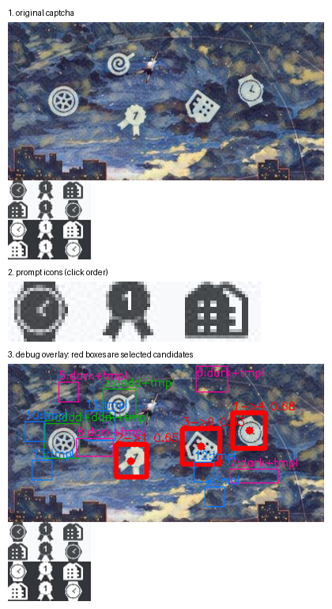
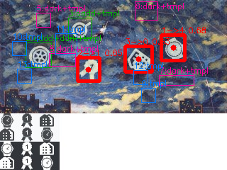

# YiDun Click Solver

> 纯 Python、无浏览器桥接的易盾点选验证码取参、识别与校验复现工程。
> 适用于 **CTF / 授权安全研究 / 本地沙箱验证** 场景，不面向未授权真实业务使用。

## 目录

- [项目简介](#项目简介)
- [功能亮点](#功能亮点)
- [Debug 示例](#debug-示例)
- [整体架构](#整体架构)
- [快速开始](#快速开始)
- [常用命令](#常用命令)
- [一键部署到群晖 NAS](#一键部署到群晖-nas)
- [识别思路](#识别思路)
- [输出字段](#输出字段)
- [项目结构](#项目结构)
- [GitHub 发布前检查](#github-发布前检查)
- [免责声明](#免责声明)

## 项目简介

`YiDun Click Solver` 将点选验证码的端到端流程拆成三层：

1. **协议与加密层**：纯 Python 复现 `core-optimi 2.28.5` 中 `/api/v3/get`、`/api/v3/check` 所需的 `cb`、点选 `data` 与 `validate` 包装逻辑。
2. **运行态参数层**：自动完成 `getconf`、IR `/v4/j/up`、`/api/v3/get` 调用，准备 `irToken`、`fp`、`dt`、`zoneId` 等运行态参数。
3. **本地图像识别层**：使用 OpenCV 模板匹配、NCC、Chamfer、SSIM 与结构评分定位三枚点选图标，并自动提交校验。

默认输出只保留真正有用的接入字段：`validate`、`raw_validate`、`token`、`points`、`fp`、`irToken`、`dt`、`zoneId`。

## 功能亮点

- **无浏览器桥接**：CLI 不依赖 Puppeteer、Playwright、DevTools bridge 或页面注入执行。
- **纯 Python 加密复现**：协议签名、私有 base64、CRC、点击数据封装均在本地完成。
- **可复现视觉管线**：以模板匹配和结构评分为主，SIFT 仅保留极低兼容权重。
- **自动化最小闭环**：取参、下载验证码、识别、校验、输出关键字段一条命令完成。
- **GitHub 友好**：运行产物默认进入 `captures/`、`results/`，并通过 `.gitignore` 避免误提交敏感数据。

## Debug 示例

下面是一次成功运行的识别过程示例。红色粗框/红点表示最终提交的三枚点选目标，蓝色/绿色等细框表示参与评分的候选区域。



| 原始验证码 | 提示区图标 | 候选框叠加 |
| --- | --- | --- |
|  |  |  |

## 整体架构

```text
getconf -> IR upload -> ensure fp -> /api/v3/get -> local CV solve -> /api/v3/check -> validate
```

核心模块对应关系：


| 模块                          | 作用                                             |
| ----------------------------- | ------------------------------------------------ |
| `src/yidun_crypto.py`         | `cb`、点击 `data`、`validate` 封装与私有编码实现 |
| `src/yidun_ir.py`             | IR 上报体构造与运行态 token 准备                 |
| `src/yidun_vision.py`         | 点选验证码图像裁剪、候选生成、评分与坐标选择     |
| `tools/yidun_click_solver.py` | 一键 CLI，串联取参、识别、校验和结果输出         |

## 快速开始

### 1. 准备环境

```bash
git clone <your-repo-url>
cd <your-repo-name>
python -m venv .venv
```

Windows PowerShell：

```powershell
.\.venv\Scripts\Activate.ps1
pip install -r requirements.txt
```

Linux / macOS：

```bash
source .venv/bin/activate
pip install -r requirements.txt
```

可选安装 `ddddocr`，作为本地候选框补充检测器：

```bash
pip install ddddocr
```

### 2. 一键运行

```bash
python tools/yidun_click_solver.py --json-out results/live_auto_validation_compact.json
```

成功后会得到精简 JSON，示例仅为占位格式：

```json
{
  "ok": true,
  "result": true,
  "validate": "CN31_xxx_v_i_1",
  "raw_validate": "76PdCuS...",
  "token": "...",
  "points": [[78, 83, 0], [176, 97, 520], [131, 41, 900]],
  "zoneId": "CN31",
  "dt": "...",
  "irToken": "...",
  "fp": "...:1781246706648"
}
```

### 3. 读取关键字段

```bash
python - <<'PY'
import json
from pathlib import Path

path = Path('results/live_auto_validation_compact.json')
d = json.loads(path.read_text(encoding='utf-8'))
print('validate =', d['validate'])
print('token    =', d['token'])
print('points   =', d['points'])
PY
```

## 常用命令

只获取验证码，不提交校验：

```bash
python tools/yidun_click_solver.py --get-only --json-out results/get_only.json
```

使用已知 token 和坐标直接提交：

```bash
python tools/yidun_click_solver.py --token <token> --points "51,67;181,88;112,42"
```

提高自动尝试强度：

```bash
python tools/yidun_click_solver.py \
  --max-attempts 10 \
  --auto-alternatives 1 \
  --json-out results/live_auto_validation_compact.json
```

实测本挑战中的 token 更接近“首个 `/check` 决定成败”：第一次坐标错后继续复用同一 token
提交候选通常不能提高通过率。默认策略因此改为 **每轮只提交 top-1 坐标，失败后刷新 token/图片重试**；
`--auto-alternatives` 主要保留给离线诊断或确认服务端是否允许同 token 多次校验。

需要完整调试细节时再开启 debug 输出：

```bash
python tools/yidun_click_solver.py \
  --output-detail debug \
  --vision-detail \
  --json-out results/debug_full.json
```

通过环境变量覆盖关键运行态参数：

```bash
YIDUN_FP="<captured-fp>" \
YIDUN_IR_TOKEN="<captured-ir-token>" \
YIDUN_DT="<dt>" \
YIDUN_ZONE_ID="CN31" \
python tools/yidun_click_solver.py
```

PowerShell 写法：

```powershell
$env:YIDUN_FP = "<captured-fp>"
$env:YIDUN_IR_TOKEN = "<captured-ir-token>"
python tools/yidun_click_solver.py
```

## 一键部署到群晖 NAS

支持 DSM 7 **Container Manager**，把求解器做成局域网 HTTP 服务。

### 1. 配置

```bash
cp .env.example .env
# 编辑 NAS_SSH（如 admin@192.168.1.50）、NAS_DIR、可选 YIDUN_API_TOKEN
```

### 2. 一键部署

```bash
chmod +x scripts/deploy-synology.sh
./scripts/deploy-synology.sh
```

脚本会 rsync 到 NAS，并在远端执行 `docker compose up -d --build`。

### 3. 调用

```bash
curl http://<nas-ip>:8765/health
curl -X POST http://<nas-ip>:8765/solve
```

若设置了 `YIDUN_API_TOKEN`：

```bash
curl -X POST http://<nas-ip>:8765/solve \
  -H "Authorization: Bearer <token>" \
  -H "Content-Type: application/json" \
  -d '{"max_attempts": 5}'
```

也可用 Container Manager 图形界面导入本仓库的 `compose.yaml`。完整说明见 [`docs/SYNOLOGY.md`](docs/SYNOLOGY.md)。

✅ 已提供：`Dockerfile`、`compose.yaml`、`tools/nas_api_server.py`、`scripts/deploy-synology.sh`

## 识别思路

视觉部分以稳定、可解释的本地 CV 评分为主：

1. **提示图标提取**：从验证码底部提示区域裁出三枚目标图标。
2. **多尺度模板搜索**：将提示图标缩放到 `20x20` 至 `50x50`，在顶部区域使用 `cv2.TM_CCOEFF_NORMED` 搜索。
3. **多视图匹配**：构造 dark、light、gray-dark、gray-light、edge 等搜索图，减少背景绘画与颜色差异影响。
4. **候选融合**：合并模板命中、暗色连通域与可选 `ddddocr` 候选，过滤重叠框和边缘噪声。
5. **局部结构评分**：对候选计算 NCC、Chamfer、SSIM、轮廓/孔洞结构、直接模板命中和可选 SIFT。
6. **全局唯一分配**：枚举三枚提示图标到不同候选框的排列，按总分排序；自动模式可提交排名靠前的候选组合。

当前固定评分公式：

```text
total = 0.50*NCC + 0.20*Chamfer + 0.15*Shape + 0.10*TemplateDirect + 0.05*SIFT
```

SIFT 仅保留 `0.05` 兼容权重，不作为主导信号。

更详细的实现说明见 [`docs/TECHNICAL.md`](docs/TECHNICAL.md)。

## 输出字段


| 字段            | 含义                                   |
| --------------- | -------------------------------------- |
| `validate`      | 给业务侧使用的最终通过凭证             |
| `raw_validate`  | `/api/v3/check` 返回的原始通过值       |
| `token`         | 本轮验证码 token，短时/一次性有效      |
| `points`        | 成功点选坐标与点击间隔                 |
| `fp`            | 指纹值；脚本会复用稳定主体并刷新时间戳 |
| `irToken`       | 本轮 IR 运行态 token                   |
| `dt` / `zoneId` | 当前易盾配置与区域参数                 |

## 项目结构

```text
.
├── src/
│   ├── yidun_crypto.py       # cb / data / validate 纯 Python 加密复现
│   ├── yidun_ir.py           # IR /v4/j/up 运行态 token 构造
│   └── yidun_vision.py       # OpenCV 点选图标识别
├── tools/
│   ├── js_crypto_oracle.mjs  # 分析期 JS 对照工具
│   ├── yidun_click_solver.py # 一键 CLI：取参、识别、校验、输出
│   └── nas_api_server.py     # 群晖部署用 HTTP API
├── scripts/
│   └── deploy-synology.sh    # 一键同步并 docker compose 部署到 NAS
├── reverse/assets/           # 逆向分析参考素材
├── captures/                 # 运行时验证码图片缓存，默认不提交
├── results/                  # 运行结果与 debug 产物，默认不提交
├── docs/
│   ├── assets/               # README/技术文档引用的 debug 示例图
│   ├── TECHNICAL.md          # 实现思路说明
│   ├── SYNOLOGY.md           # 群晖 NAS 部署说明
│   └── PUBLISHING.md         # GitHub 发布检查清单
├── Dockerfile                # Container Manager / Docker 镜像
├── compose.yaml              # 群晖项目 / 本地 compose
├── .env.example              # NAS 部署环境变量模板
├── requirements.txt
└── README.md
```

## GitHub 发布前检查

- `captures/`、`results/` 只提交 `.gitkeep`，不提交运行时 token、fp、validate 或验证码缓存。
- `docs/assets/` 只保留用于 README 展示的脱敏 debug 示例图。
- 发布前可执行：

```bash
python -m py_compile src/yidun_crypto.py src/yidun_ir.py src/yidun_vision.py \
  tools/yidun_click_solver.py tools/nas_api_server.py
```

## 友链

- [Linux.do](https://linux.do/)

## 免责声明

本项目仅用于 CTF、授权测试和本地沙箱研究。请勿在未授权的真实业务、账号或第三方系统中使用。使用者需自行承担合规与风险责任。
