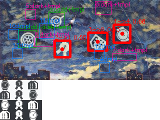
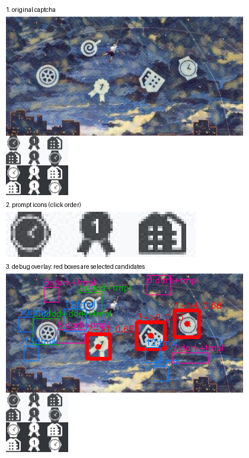

# Technical Notes

本文档记录 `YiDun Click Solver` 的核心实现思路，方便后续复盘、审计和二次开发。

## 1. 设计目标

项目目标不是“调用浏览器跑页面 SDK”，而是把可复现的关键逻辑沉淀到本地 Python：

- 协议层：请求参数、签名、点击数据封装可以离线构造。
- 运行态：`irToken`、`fp`、`dt`、`zoneId` 等参数来源明确，可缓存、可覆盖、可调试。
- 视觉层：点选坐标由本地 OpenCV 计算，不依赖远程识别服务。
- 输出层：默认只输出接入必需字段，避免调试噪声污染结果。

## 2. 协议与加密层

核心文件：`src/yidun_crypto.py`

实现内容包括：

- 私有 base64 字母表与 padding。
- 字节规范化、CRC32、字符串/字节互转。
- SDK 中 `xorEncode` 等编码路径的 Python 等价实现。
- `/api/v3/get` 和 `/api/v3/check` 所需 `cb` 构造。
- 点选坐标、时间线与 token 组合后的 `data` 构造。
- `raw_validate` 到业务侧 `validate` 的格式封装。

这部分的原则是：**用 Python 复刻算法，不在运行时调用浏览器或 JS bridge**。

## 3. 运行态参数层

核心文件：`tools/yidun_click_solver.py`、`src/yidun_ir.py`

默认链路：

```text
getconf -> IR upload -> fp prepare -> /api/v3/get -> /api/v3/check
```

关键点：

- `getconf` 用于取得当前配置中的 `dt`、`zoneId`、IR 产品参数等。
- `src/yidun_ir.py` 构造 `/v4/j/up` 上报体，得到本轮 `irToken`。
- `fp` 采用“稳定主体 + 刷新时间戳”的策略，降低每轮完全随机导致的不稳定性。
- `--get-url` 可从已抓取的 `/api/v3/get` URL 中反解析 `irToken`、`fp`、`dt`、`zoneId`。
- `--token` + `--points` 可跳过 `/get`，直接复放指定 token 与坐标。

## 4. 图像识别层

核心文件：`src/yidun_vision.py`

当前点选验证码布局假设：

```text
320x160 顶部区域：候选图标与背景图
底部提示区域：需要依次点击的三枚图标
```

识别步骤：

1. 从底部提示区裁剪三枚目标图标。
2. 为每枚目标图标生成多尺度模板。
3. 在顶部区域做多视图匹配，包括灰度、边缘、暗色/亮色假设等。
4. 合并模板候选、连通域候选与可选 `ddddocr` 候选。
5. 对候选进行局部评分：
   - NCC：主相似度信号。
   - Chamfer：边缘/轮廓距离。
   - SSIM：局部结构一致性。
   - Shape：孔洞、轮廓、面积比例等结构特征。
   - TemplateDirect：模板搜索阶段的直接命中分数。
   - SIFT：可选兼容信号，权重很低。
6. 枚举三枚目标图标到不同候选框的排列，选择全局总分最高的组合。

固定评分公式：

```text
total = 0.50*NCC + 0.20*Chamfer + 0.15*Shape + 0.10*TemplateDirect + 0.05*SIFT
```

### Debug 图示

下面几张图来自一次成功运行，便于对照识别流程和 debug 标注含义。

原始验证码：


提示区三枚图标，顺序就是提交点击顺序：


候选框与最终选择叠加图：红色粗框/红点是最终选中的三枚候选，蓝色/绿色等细框是参与评分的候选区域。



三图合并总览：



## 5. 自动尝试策略

`tools/yidun_click_solver.py` 默认启用 `--auto`：

- 先获取新 token 和验证码图。
- 本地识别候选组合。
- 默认只提交排名第一的候选组合到 `/api/v3/check`。
- 如失败，立即在 `--max-attempts` 范围内刷新验证码和 token 重试。
- `--auto-alternatives > 1` 仍可用于调试候选排序，但 live token 首次 `/check` 错误后通常会被消费，
  因此默认不再把请求预算浪费在同一个 token 的后续候选上。

常用参数：

| 参数 | 作用 |
| --- | --- |
| `--max-attempts` | 失败后最多刷新验证码重试次数；默认 10 |
| `--auto-alternatives` | 单轮同 token 最多尝试多少个候选组合；默认 1，建议 live 保持 1 |
| `--auto-alternative-delay-ms` | 候选组合之间的提交间隔 |
| `--output-detail debug` | 输出完整调试结构 |
| `--vision-detail` | 输出每个候选的详细视觉评分 |
| `--debug-dir` | 保存失败图片和 debug JSON 的目录 |

## 6. 调试建议

- 只需要最终接入字段时，保持默认 `--output-detail useful`。
- 排查视觉误判时，再开启 `--output-detail debug --vision-detail`。
- auto 失败会生成 `results/debug_auto_attempt_*.png` 等文件，发布前必须清理。
- 如果 `fp` 来源不稳定，可显式传入 `YIDUN_FP` 或 `--fp-cache` 指定缓存路径。
- 如果运行环境路径含中文，图像读取已通过 `cv2.imdecode(np.fromfile(...))` 规避 `cv2.imread` 的路径兼容问题。

## 7. 边界与假设

- 当前实现针对点选类 `type=7` 图像布局。
- 视觉识别依赖图像尺寸、提示区位置和渲染风格；若目标布局变化，需要重新校准裁剪区和候选过滤条件。
- token、validate、fp、irToken 均具有时效性或环境相关性，不应作为静态测试数据提交到公开仓库。
